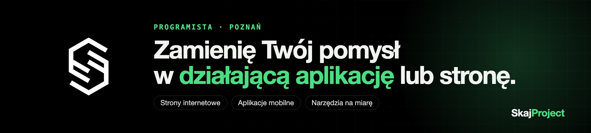
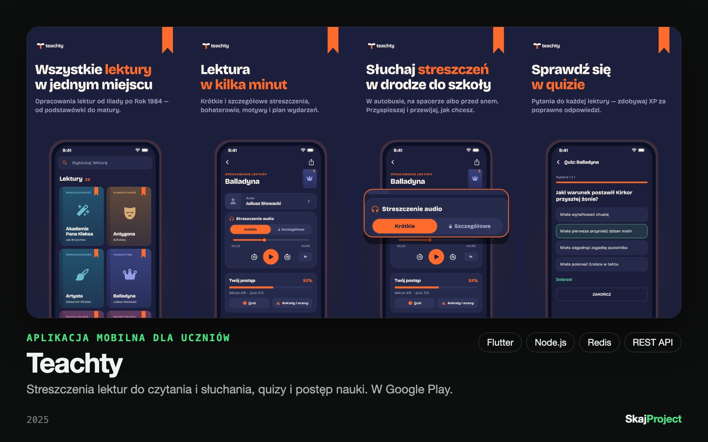
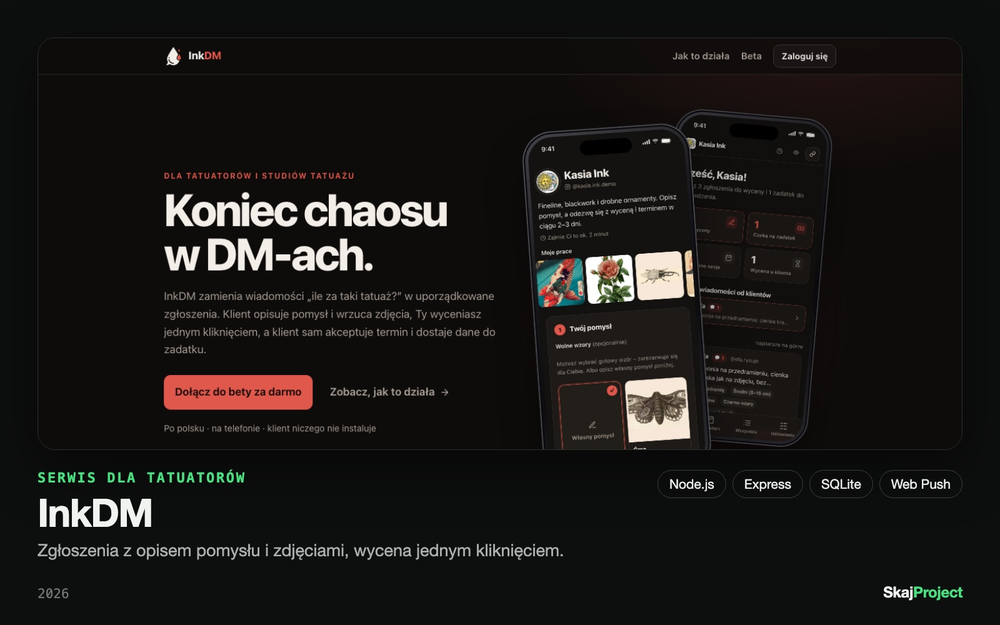
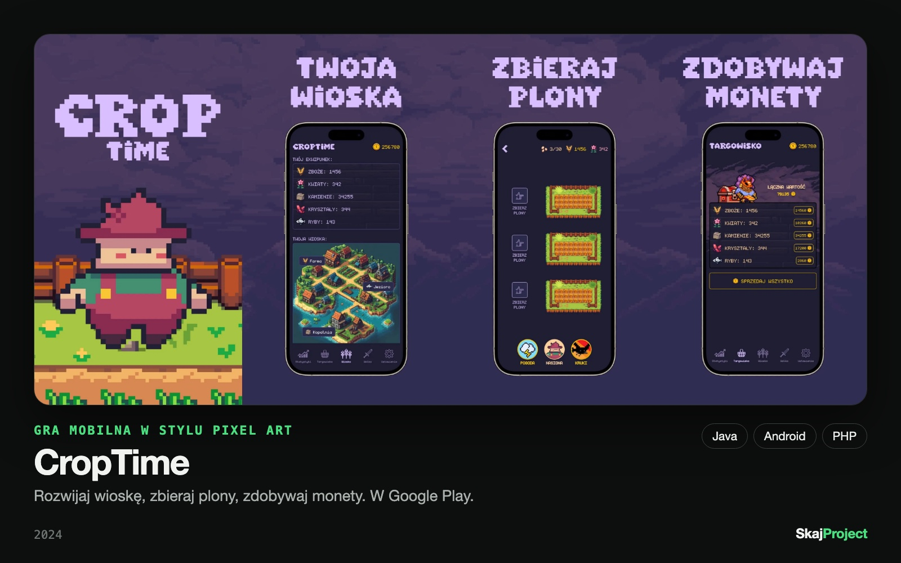
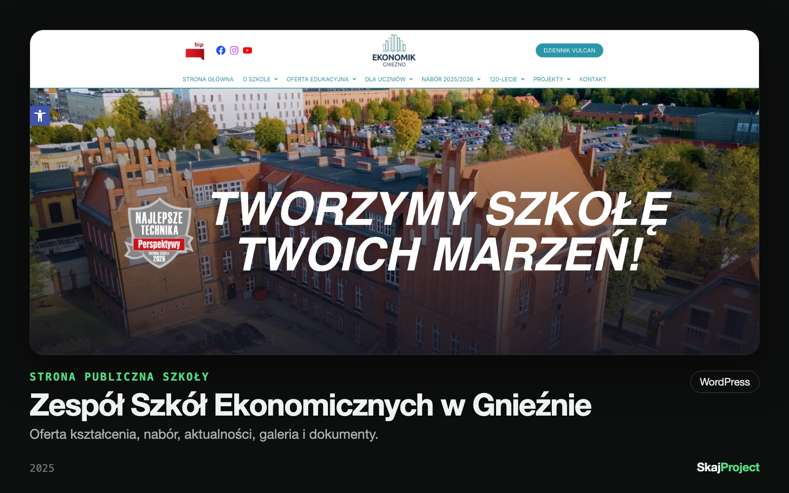
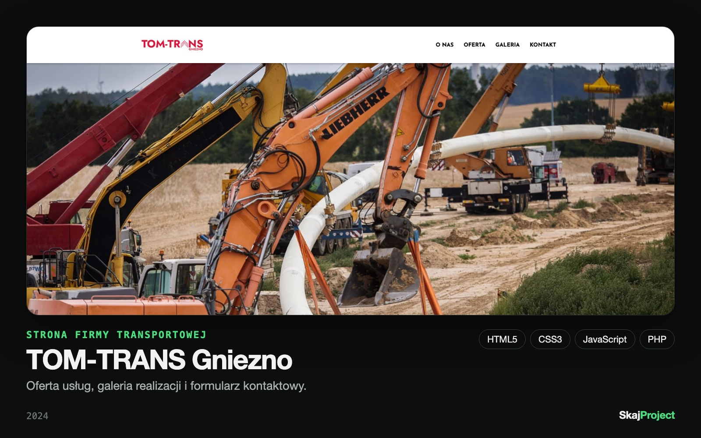

  

<h1 align="center">Piotr Woźniak · SkajProject</h1>

  <b>Full Stack Developer z Poznania.</b> 
  Strony i sklepy, aplikacje mobilne i webowe, boty, panele i automatyzacje. Od pomysłu do działającego produktu.

  
  
  
  

---

## Co robię i dla kogo

Pracuję solo, dla małych firm i osób z pomysłem na własny produkt. Biorę na siebie całość: projekt, kod, wdrożenie i to, co dzieje się po premierze.

- 🌐 **Strony internetowe i sklepy**: strony firmowe, wizytówki, sklepy
- 📱 **Aplikacje mobilne i webowe**: Flutter, Android (Java), Node.js
- 🤖 **Boty, panele i automatyzacje**: narzędzia, które zdejmują z Ciebie powtarzalną robotę
- 🔧 **Poprawki i rozbudowa**: ratuję i rozwijam istniejące systemy

Mam na koncie **280+ zleceń na Useme**, od drobnych skryptów i automatyzacji po pełne aplikacje.
Pracuję z narzędziami AI, ale za architekturę, logikę i jakość odpowiadam ja.

> 🇬🇧 *Freelance full-stack developer based in Poznań, Poland. Websites, mobile & web apps, bots and automation for small businesses. Open to new projects.*

## Realizacje

Kod komercyjnych projektów jest prywatny, więc pokazuję efekt: ekrany, stack i działające wersje.

<table>
  <tr>
    <td width="50%" valign="top">
       
      <b>Teachty</b>: aplikacja mobilna z opracowaniami lektur, quizami i postępem nauki. 
      Flutter · Node.js · MySQL · Redis · Firebase 
      <a href="https://play.google.com/store/apps/details?id=com.skajproject.teachty">Google Play</a> · <a href="https://teachty.com">teachty.com</a>
    </td>
    <td width="50%" valign="top">
       
      <b>InkDM</b>: serwis dla tatuatorów. Zgłoszenia, wyceny i zadatki zamiast chaosu w DM-ach. 
      Node.js · Express · SQLite · Web Push 
      <a href="https://inkdm.pl">inkdm.pl</a> (beta)
    </td>
  </tr>
  <tr>
    <td width="50%" valign="top">
       
      <b>CropTime</b>: gra mobilna w stylu pixel art. Wioska, plony, targowisko. 
      Java · Android · PHP · Firebase 
      <a href="https://play.google.com/store/apps/details?id=com.skajgames.croptime">Google Play</a>
    </td>
    <td width="50%" valign="top">
       
      <b>Zespół Szkół Ekonomicznych w Gnieźnie</b>: strona publiczna szkoły z ofertą, naborem, aktualnościami i galeriami. 
      WordPress 
      <a href="https://ekonomik.gniezno.pl">ekonomik.gniezno.pl</a>
    </td>
  </tr>
  <tr>
    <td width="50%" valign="top">
       
      <b>TOM-TRANS Gniezno</b>: strona firmy transportowej z ofertą, galerią realizacji i formularzem kontaktowym. 
      HTML5 · CSS3 · JavaScript · PHP 
      <a href="https://tomtrans-gniezno.pl">tomtrans-gniezno.pl</a>
    </td>
    <td width="50%" valign="top"></td>
  </tr>
</table>

## Stack

  

## Współpraca

Masz pomysł, stronę do zrobienia albo system, który wymaga poprawek? Napisz: **skajproject@gmail.com** lub przez [LinkedIn](https://www.linkedin.com/in/piotrwozniakk/). Więcej na [skajproject.com](https://skajproject.com).
